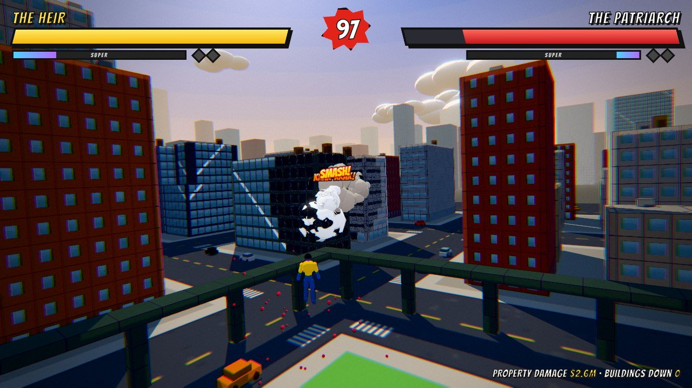
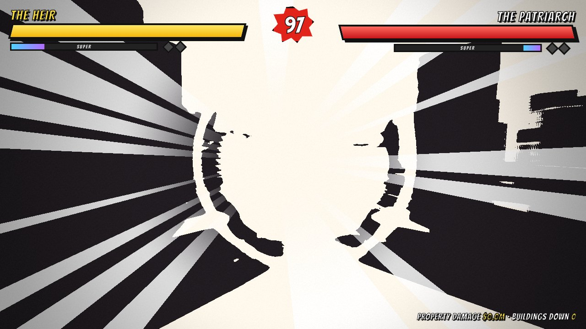
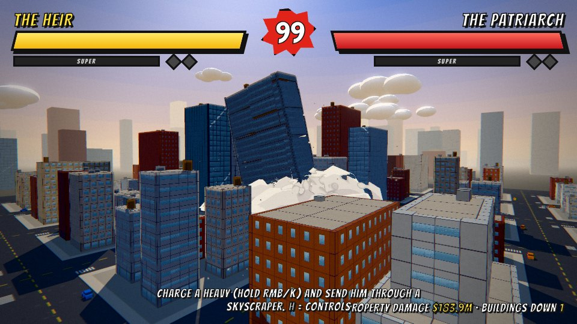
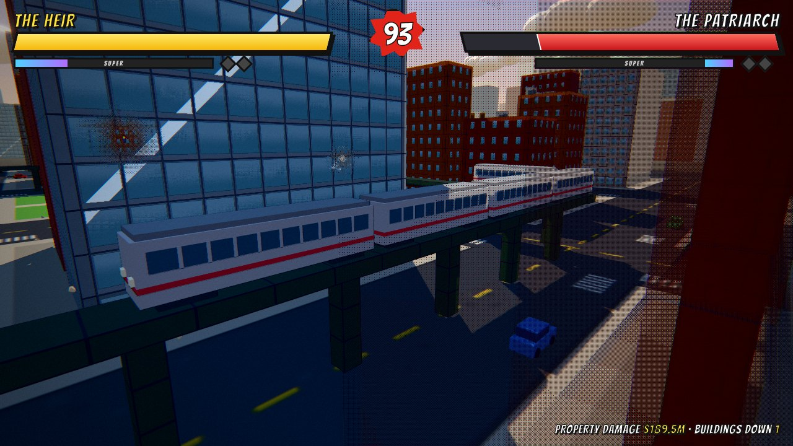
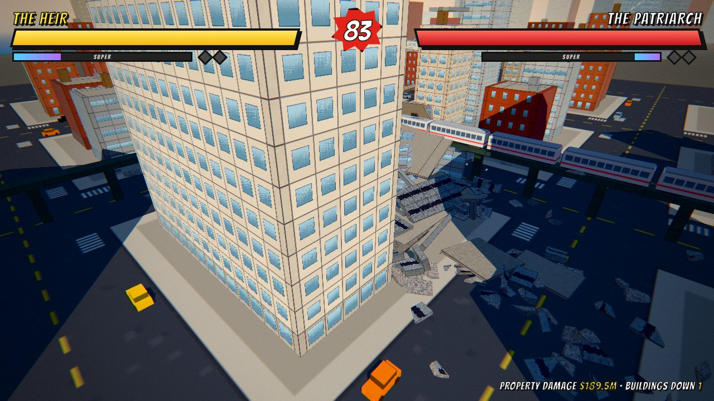

# BLOODLINE — a superpowered destruction fighter (tech demo)

A playable browser tech demo of a 3D flying-superhero brawl in the spirit of the father-vs-son
fight from *Invincible* (S1E8): bodies punched through skyscrapers, towers toppling, craters,
a derailed elevated train, and as much feedback ("juice") per hit as I could fit.

You are **THE HEIR** (yellow/blue). The bot is **THE PATRIARCH** (white suit, red cape, moustache).
The characters, names and city are original; the fight is an homage.



| Impact frame (full-charge punch) | Tower collapse (lean + pancake) |
|---|---|
|  |  |
| **Elevated train** | **Aftermath: frozen rubble** |
|  |  |

**Stack:** three.js r186 (WebGL2) · Rapier 0.21 (WASM, SIMD build) · Vite · plain ES modules.
Every mesh, texture and animation is procedural. Sound is recorded samples and ElevenLabs sound
effects, with a little procedural sub-bass under the punches (see [Audio](#audio)).

## Run it

```bash
npm install
npm run dev        # open the printed URL (Chrome / Edge / Firefox, desktop GPU recommended)
npm run build      # static build in dist/ (relative paths; host anywhere)
npm run preview
```

**Host it:** `.github/workflows/pages.yml` deploys to GitHub Pages. Set Settings → Pages → Source to
"GitHub Actions", then run the workflow from the Actions tab. `node tools/build-artifact.mjs <dir>`
repackages `dist/` as a claude.ai Artifact page plus its JS chunks.

Useful URL flags: `?fight` (skip the title), `?diff=training|sparring|brutal|viltrumite` (default: sparring),
`?quality=high|medium|low`, `?seed=1234` (different city), `?auto` (bot vs bot attract mode),
`?map=grid` (the procedural city; the default is `flatiron`, real Manhattan, see [below](#real-nyc-madison-square--flatiron)),
`?weather=golden|dusk|storm|night|random` (default: golden, see [Weather and light](#weather-and-light)),
`?tutorial` (straight into the [tutorial](#tutorial)).
`?fight` and `?auto` skip the round opener and start the fighters close together, as the
`tools/s_*.mjs` scenarios expect; `?intro` forces the opener anyway, `?nointro` drops it.
`?norecap` skips the highlight recap after the match. `?mute` starts with all sound off (M toggles it).
The title screen's **City** and **Weather** menus switch maps and weather too and remember the choice.
Its **Controls** button opens the full controls list (keys, the connected pad's buttons, or the
touch buttons); **Tutorial** teaches the moves one at a time.

## Controls

| Keyboard / mouse | Gamepad | Action |
|---|---|---|
| W A S D | left stick | Fly toward / around the opponent (lock-on) |
| Space / C | RT / LT (analog), right stick | Up / down |
| Shift (tap) | A | Dash (i-frames) · **rush** after a launched enemy · **air-recover** when launched |
| Shift (hold) | A (hold) | Boost flight: above ~42 m/s you plow through buildings |
| LMB / J | X | Punch combo: jab → cross → hook → smash (launcher) |
| RMB / K (hold) | Y | Heavy; hold to **charge** (up to 195 m/s launch). Reaches him from **any distance**: out of range you rocket at him first, through whatever's in the way. +Space / RT = uppercut, +C / LT = meteor smash |
| G | D-pad up | **Skyward**: shoot ~110 m straight up over the city, hang there (slow motion, wide view), then LMB / RMB **dives** on him and spikes him into the street |
| E / L / MMB | B | **Grab → drag** him through buildings (steer with WASD) **→ throw**. Like the heavy, it reaches him from **any distance**: out of range you fly at him, both hands out, and grab on arrival |
| Q / F | LB | Block; tap just before a hit to **parry** (slow-mo + stagger) |
| R / U | RB | **Super**: grab, 10-punch barrage, finisher (full meter) |
| Esc · H · M | Start (Menu) · Back (View) · – | Pause · controls · mute |

**With a gamepad** (`src/core/input.js`, menus in `src/game/padmenu.js`), any pad the browser
reports with the standard mapping works: Xbox, PlayStation, Switch Pro and most others.
- Plug it in or pull it out at any time; Chrome only reveals a pad after a button press on the
  page. Unplugging the pad you're playing on pauses the fight.
- The controls panels (title, pause, Back in a fight) list the connected pad's own button names
  (Xbox above, ✕ ○ □ △ / L1 R1 L2 R2 on PlayStation), and the fight's hints name them too.
- Menus: the D-pad or left stick moves a highlight, A presses, B backs out of the pause menu and
  Start fights from the title. On Quality / City, press A, pick with ← / →, then A to apply (the
  page reloads) or B to keep the old one.
- Sticks have a 20% radial dead zone and reach full speed just short of the rim. The triggers fly
  up / down in proportion to the pull, and past halfway they also count as Space / C, so RT + Y
  is the uppercut and LT + Y the meteor smash.
- Hits rumble (dual-rumble, scaled by hit strength) on pads and browsers that support it, and
  only while the pad is what you're playing with.

**On a phone or tablet** (`src/game/touch.js`), on-screen controls appear during a fight:
- the left half of the screen is a floating stick that appears under your thumb. It follows him
  up and down, so there are no up / down buttons;
- above the stick, SKY is the skyward move: tap it, then PUNCH or HEAVY to dive on him;
- the right thumb gets PUNCH, HEAVY (hold to charge), DASH (hold: boost), GRAB (tap again to
  throw), BLOCK and SUPER, which lights up at full meter;
- the pause button sits under the timer.

Every control tracks its own finger, so they combine freely. The layer hides on the title, pause
and results screens so those keep normal taps. Add `?touch` to the URL to force it on a desktop.

Phones are tuned for portrait; landscape works too. On a tall screen, `src/game/camera.js` does
three things: it widens the vertical FOV so there is still some view to the sides, it sits further
back and centred behind the Heir, and it renders the lower part of a taller frustum
(`setViewOffset`). That lifts the fight into the top half of the screen, above the thumbs.

Best of 3 rounds. **The city remembers**: destruction persists between rounds and rematches.
When the match is won, a **recap** of its best moments plays (any key or tap skips it; see
[Match recap](#match-recap)). The results screen offers **Watch recap** (R), **Rematch** (Enter),
**New city** (N), **Fly around** (X) and **Main menu**; Pause → *New city* also builds a fresh one.

**Fly around** is free roam over the wreckage: the Heir (back on his feet if he lost) flies where
the camera looks (WASD, Space / C, or the left stick), holding Shift / A boosts him through
buildings, and dragging the mouse or the right stick looks around; let go and the camera swings
back in behind him. Esc, Enter or Start brings the results back.

### Tutorial

The title's **Tutorial** (`src/game/tutorial.js`, or `?tutorial`) teaches every move against the
training dummy, one step at a time: fly, up and down (not on touch, where the stick follows him),
punch, the four-hit combo, dash, rush, heavy, charge, block, grab, skyward, dive and super. Each
step unlocks its move and waits until you've done it. Moves not taught yet do nothing, and on a
touch screen their buttons aren't there yet: each pops in with its step and glows until used, so
the controls fill up as you learn them. The dummy plays along where a move needs him to. For
BLOCK he closes in and jabs every 1.5 s; for GRAB he backs off to 30 m so the grab has to reach
him. There's no clock and nobody is knocked out (damage stops at 1 HP); both fighters heal.
The card's **Skip ›** or Pause → *Skip step* moves on. The last step ends on **Fight him**
(a sparring match in the same city), **Keep practising** (every move unlocked, no steps) or
**Main menu**.

## What to try

1. Hold **K** until the flash, release next to the Patriarch. Aim-assist bends big launches
   toward the nearest building, so he leaves a body-shaped hole through it.
2. Tap **Shift** while he's flying away, catch up in slow-mo, and hit him again.
3. **E** to grab him, steer into a skyscraper or the elevated train, and release to throw.
4. In **Training** mode he never fights back: knock out a whole storey of a tower to watch it lean,
   creak and pancake into its own dust cloud.

## The destruction system

Everything breakable (about 29k chunks, 100+ structures plus the elevated viaduct) lives in **one
`InstancedMesh`**. A building is a grid of chunks:
- thin facade panels on the perimeter;
- corner columns;
- 3×3-cell floor slabs inside;
- rooftop clutter on top.

Setback towers get two or three tiers.

**1. Impact gradient** (`src/world/structures.js → impact()`). Every hit is a sphere. Chunks are
classified by distance into concentric zones:

| Zone | What happens | Implementation |
|---|---|---|
| core | pulverized | non-physics rubble pebbles + dust |
| mid | Voronoi-fractured | 5–8 convex-hull shards from a pre-computed library |
| outer | detached whole | one rigid body |
| shatter ring | windows blow out | glass shards + broken-window shader state |
| crack ring | soot, radial cracks, cracked glass | shader-only damage |

At most 3 fractures per impact; the rest detach or pulverize. This follows the shipped-game
consensus: pre-fracture at load time and show every scale at once.

Each chunk remembers the impact that reached it hardest (point and radius, the `aHit`
attribute). The shader fades the damage out from that point, so a hole gets soot in two comic
bands, inked cracks radiating across the facade and a ring around the crater. Each window judges
the damage at its own centre: blown out near the hole, spiderweb-cracked further out, intact
beyond. Debris keeps the impact, so a chunk's damage carries over when it breaks off.

**2. Seamless hand-off** (`src/world/chunkMaterial.js`). A single toon shader draws the facade in the
chunk's *parent* space:
- windows, mullions, brick courses and ink edges;
- glass with comic glints;
- blown-out windows.

A chunk that turns into debris therefore looks identical on the frame it detaches. Voronoi shards
show their slice of the window, and freshly cut faces show raw concrete. Merged collapse slabs
repeat the window pattern per original cell. A derivative-based LOD fades the pattern to its
average colour at distance, so there's no moiré.

**3. Structural integrity**. Each storey keeps its wall ratio; a storey below ~42% (±12% per
building) fails. A flood fill from the ground catches anything left hanging (severed corners, cut
viaduct spans).

**4. Collapses that read as heavy**:
- a 0.45–0.75 s **wind-up**: metal groan, dust trickling out of the failing storey, a few bits shedding;
- the failure **propagates outward** at 18–30 m/s instead of everything letting go at once;
- every released piece gets the same rigid-rotation velocity field `v = ω × (p − pivot)`, so the upper
  section **tips over as one mass** toward the damaged side;
- the section falls as a few heavy bodies: whole floor plates, facade strips up to 6 panels × 2
  storeys, and 4-storey corner columns;
- if the falling mass is large relative to what's below, the lower storeys are **crushed one after
  another**, about one per free-fall interval, each with a dust ring, a boom, some shake and dust
  blasting out of its windows. That's the pancake;
- the pancake stops one to four storeys up, and the **stump** gets a ragged, scorched top;
- falling facades lose most of their glass, which rains off them;
- the **dust is timed to the fall** (real gravity): a plume boils up the height the mass still
  spans, the base keeps pushing billows into the street while it pours down, and when the top
  lands a surge rolls out down the street canyons. Collapse clouds have a smoke budget of their
  own, so the dust a tower makes can't thin out its own cloud;
- the **rubble piles up** in the heightfield over the footprint in three goes, with painted
  rubble and a film of dust on the streets around it.

**5. Progressive crumble** (`src/physics/debris.js`). Contact-force events, normalized by mass, break
pieces on hard landings:
- a big slab splits in halves along its longest axis;
- then quarters;
- then single panels;
- then Voronoi shards.

Each break adds only a few bodies, so a collapse never bursts the budget at once. Every hard
knock also cracks a piece up a little more, and wrecked pieces gather dust on whatever faces up,
so settled rubble looks like rubble. Big collapse pieces trail dust on the way down and throw out
a skirt of dust (and a bit of shake) when they hit the street.

**6. Budgets and freezing**. Rapier bodies are capped at 420 / 300 / 170 (high / medium / low).
Settled pieces are **frozen into static rubble**: the body is removed but the instance stays, so the
city accumulates real debris piles. Later shockwaves **re-wake** nearby frozen rubble through a
spatial hash. Collapses may evict small in-flight shards (swapped for pebbles) to make room for the
heavy pieces.

**7. Ground**. A 280×280 deformable heightfield (mesh and Rapier collider share the data) takes:
- craters: a bowl plus a raised lip;
- skid trenches when a body grazes the street at speed;
- cracks, scorch and blood painted into the street canvas.

**8. Props**:
- About 150 parked cars stay `Fixed` until a shockwave or body disturbs them. They then become
  dynamic, get wrecked (some explode) and refreeze when calm.
- The elevated train is kinematic on a destructible viaduct. Hit a car at speed, or destroy the
  track under it, and every car derails with its momentum.

### Keeping the fight readable

Early playtesting showed the screen spending most of a fight buried in dust. The fixes
(`src/fx/smoke.js`, `src/fx/fx.js`):
- Smoke has two layers with the same cel shading. Hit puffs, fire and black smoke stay opaque,
  inked billows; the big **dust clouds** from breaks and collapses are **see-through**.
- Smoke clears out of a **visibility tunnel** from the camera to each fighter (dust fades, opaque
  puffs halftone-dither like the buildings), so both fighters stay visible through any cloud.
- Smoke clears within a few metres of the camera, and a puff that would swallow the camera is
  culled outright, so it never fills the screen.
- Chunk-break dust is smaller and shorter-lived, and dust spawns thin out as the smoke pool fills.
  A collapse still gets its big cloud, but it settles in seconds.

### Scale: the opener, the camera and quiet moments

Fighting at arm's length in front of 100 m buildings hides the city. Four things push back.

- **Round opener** (`src/game/intro.js`). This is a short film, skipped by any key or tap:
  - Round 1 opens on a letterboxed aerial shot up 5th Avenue toward the Empire State, with a
    "NEW YORK CITY" location card.
  - The Patriarch drops out of the sky past the Flatiron's prow and craters the plaza. The Heir
    comes down into Madison Square Park in slow motion.
  - A crane shot descends behind him to where the fight camera takes over. Each map gives its
    landing marks, vista and caption.
  - Rounds 2 and 3 get a 4-second flyover of the wrecked arena and a double landing. By then a
    landing mark is usually last round's crater or a rubble pile, so each fighter comes down on
    the flattest open ground within ~36 m of it instead.
  - Rounds start on the ground about 80 m apart, so the first thing you do is fly at him over
    the city.
- **Camera** (`src/game/camera.js`). How far apart the fighters are sets the framing:
  - Far apart, it pulls back to about 30 m and up to about 15 m, with a wider FOV, so the
    skyline is in shot.
  - In melee it is back over the shoulder.
  - When a building collapses in view it glances at it for a couple of seconds.
  - A spring arm keeps it out of buildings.
- **Breathers** (`src/game/ai.js`). After an exchange the Patriarch sometimes breaks off. He
  climbs 35–60 m above you, hovers about 40 m away with a line ("Look at this city."), then
  dives back in, half the time as a dive-bomb. It happens more often on easier difficulties. He
  also tries to sidestep your dives.
- **Skyward and long reach** (`src/game/fighter.js`). G / SKY rockets you ~110 m up through the
  street canyon. At the top time slows and the camera opens onto the city to the horizon; an
  attack then dives on him at 185 m/s. The dive steers only gently over its last 25 m, so a late
  dodge makes it crater the street. A heavy released out of reach flies at him first
  (`homing`, 150 m/s, plowing through buildings), so RMB connects from anywhere.
- **New York.** Landmarks are called out when they fall ("THE FLATIRON BUILDING IS DOWN!"), and
  a good share of the parked cars are yellow cabs.

### Weather and light

A match is lit by one of four looks (`src/render/weather.js`): **Golden hour** (the default),
**Crimson dusk**, a **Thunderstorm** and **Night**. The title's **Weather** menu picks another, or
Random for a new one each match. One set of numbers per look drives:
- the sun (the moon at night): direction, colour and strength, plus the sky light;
- the sky: gradient, a drifting cel-shaded cloud deck lit from the sun's side, the disc and its
  glow, stars;
- fog, exposure, bloom and a colour grade (shadows and highlights each pulled toward a tint);
- **light shafts** through gaps in the skyline (a post pass that marches toward the sun and
  gathers open sky from the depth buffer);
- **lit windows** after dark (the skyline glitters, even in the far filler blocks) and **fires** in
  the blown-out windows around impacts, cel flames with a hot core;
- a rim light on the fighters, so they stand out from a dark city;
- the dust's colour, so a cloud doesn't glow at night;
- **rain** (streaks in a box around the camera, animated on the GPU, with a rain bed in the mix)
  and **lightning**: a jagged, branching bolt into the skyline, the city flashing and thunder
  arriving at the speed of sound.

The final round pushes the look further: golden hour sinks toward dusk, dusk into the blue hour,
the storm gets heavier (more rain, more lightning), and the night burns harder. On Random each
rematch rolls a new sky over the same wrecked city. Every change eases in over a few seconds.

### Match recap

After the winner's banner, the match's best moments come back as a short letterboxed film,
shot from new angles (`src/game/recorder.js`, `src/game/recap.js`). It runs 15–30 seconds; any
key or tap skips to the results, and **Watch recap** plays it again.

- **Recording.** The recorder never steers the simulation. After each step it samples what's on
  screen, and it listens in on the systems that change it:
  - the fighters' full pose every frame (root, joints, arm smear, hit flash, bruises, trails);
  - the instance matrices of live debris, tumbling cars and the train, 20 times a second;
  - for the whole match, when each city chunk broke and when debris pieces spawned, settled or
    vanished;
  - every particle, shockwave and comic-word spawn, sound, screen flash and camera shake, as
    the call that made it.

  Moving data older than 8 seconds is dropped unless it belongs to a highlight, so a match holds
  a few MB.
- **Highlights.** The game marks big launches, smashes through buildings, street slams, sky
  dives, supers, the train, building collapses (landmarks count extra) and KOs. Moments close
  together merge into one clip; the best seven are kept while the match runs. The recap takes the
  final KO plus the best of the rest that fit in about 30 seconds, in match order.
- **Playback.** The simulation stands still. For each clip the recap rebuilds the city as it
  was: standing chunks from their break times, debris from the match-start snapshot plus every
  change since, rubble mounds rewound to when they were raised. It then replays fighters, debris,
  effects and sounds against its own camera.
  Afterwards everything is put back as it was, so a rematch continues in the same wrecked city.
- **Direction.** Each clip is cut into shots around its two or three biggest moments:
  - a wide orbit or a low angle on the way in;
  - a side-on close-up of each big hit, slowed right down;
  - a tracking shot alongside whoever's flying;
  - a tower coming down, from a helicopter above the roofs around it (any lower, and in
    Midtown the lens stares at the building next door);
  - the sky diver from above and behind.

  The best hit of the match gets a second look from the reverse angle. Camera spots are checked
  against the city *as it was at that moment* (no lens inside a wall, under a roof or in a park
  tree), and hit flashes are resized for the new lens.

### Beyond the arena

The destructible core is a 6×6-block downtown. Around it (`createSkyline` in
`src/world/city.js`):
- the streets (asphalt, sidewalks, curbs, lane markings) continue across the outer floor;
- nine rings of non-destructible filler blocks with the same facades, tallest next to the arena and
  thinning out toward the horizon;
- far skyline silhouettes and blinking aircraft-warning lights sit in the haze.

The playable area is a square. When a fighter nears its edge, a patch of glowing "force
field" fades in around them (`src/world/boundary.js`), so the limit reads as part of the world
rather than an invisible wall.

### Real NYC: Madison Square / Flatiron

The default map drops the fight into real Manhattan (the procedural downtown is one click away
in the City menu): the 456 m arena is centred on Madison Square
Park, with the Flatiron Building's wedge, the Met Life Tower and the New York Life Building
inside it. The Empire State and the Midtown skyline rise to the north, between the Hudson and the
East River. The elevated train loops the park along 5th Ave, 26th St, Madison Ave and 23rd St.

- **Data.** `tools/extract-nyc-map.mjs` cuts the area out of
  [Slop New York](https://github.com/mrdoob/slop-newyork)'s processed NYC Open Data. That repo
  packs building footprints and roof heights into a compact binary of zigzag-varint deltas, plus
  curb-line blocks, street centrelines, parks and shorelines. The extractor writes
  `src/world/maps/flatiron.json` in this game's frame: metres, axes turned 29° so the street grid
  is axis-aligned, origin at the park. The file is 339 KB (106 KB gzipped) and loads only when the
  map is picked.
- **Buildings** (`src/world/realCity.js`):
  - **Footprints.** The 221 footprints in the arena are rasterised onto one shared 3 m grid,
    tallest first, so neighbours never overlap.
  - **Walls.** Each building gets 1 m wall strips only on the cell sides that have a face, so
    wedges and L-shapes keep the usual wall / corner / slab anatomy. Collapse, pancaking and
    integrity work unchanged.
  - **Party walls.** They stay out while a neighbour hides them. Above the neighbour's roof they
    are blank brick on walk-ups, and windows on towers.
  - **Setbacks.** Big pre-war towers get 1916-zoning setbacks.
  - **Intact colliders.** A few boxes hug each shape instead of one bounding box.
- **Chunk budget.** Real Manhattan is far denser than the procedural blocks, so tall buildings use
  7.2 m double-storey chunks and neighbouring facade panels pair up. The window pattern stays every
  3 m × 3.6 m through a per-chunk `cell` override. That gives about 40k chunks on high versus 29k
  procedural, and 25k on low versus 19k.
- **Ground.** Real blocks with exact 4.6 m sidewalks, NYC lane paint (double yellow on two-way
  streets), zebra crossings wherever two centrelines cross, parked cars on real curbs, and a
  leafy park whose trees get stripped by ground blasts. A 4 km outer plane holds the surrounding
  blocks, the boroughs and the rivers.
- **Landmarks.** The survey has one roof height per footprint. The Flatiron and the Met Life Tower
  get their colours; Met Life and New York Life get gilded pyramid crowns. The Empire State is
  hand-built (the survey's version is a single 378 m box), as Slop New York does.

Footprints, roof heights, street centrelines, parks and borough boundaries come from
[NYC Open Data](https://opendata.cityofnewyork.us/), processed by Slop New York (MIT).

### Things measured during development (and the fixes)

- **The first contact of a new kind stalls Chrome for about 100 ms.** Chrome compiles WebAssembly
  lazily, so this happens the first time hull-vs-hull or hull-vs-heightfield contacts run. Fix: a
  throwaway warm-up simulation at load (`Physics.warmup`).
- **"Sleeping" bodies were costing 15 ms per step.** Rebuilding colliders woke them, and Rapier 0.21
  puts whole islands to sleep together. Fix: parked cars are `Fixed` until disturbed, and debris
  freezes based on its *own* velocity, not `isSleeping()`.
- **Thin floor-slab slivers tunnel through the heightfield.** Fix: slabs never Voronoi-fracture, and a
  safety net pops anything under the ground back up and parks it.
- **Collapse cost.** p50 of 13 ms of CPU simulation for a full 30-storey collapse on the 4-core
  container used for development, which is slower than a typical desktop. The SIMD Rapier build is
  10–30% faster than the scalar one.

## The juice catalog

One **strength** value per hit drives every channel together (`src/game/juice.js`), so a jab and a
skyscraper-ending haymaker stay proportional:

| Channel | Implementation |
|---|---|
| Hitstop | Tiered by hit: about 4 frames for jabs, about 10 for heavies, 15–25 plus slow-mo for launchers. The world freezes; shake, text and flash run in real time. |
| Camera | Trauma-based shake (`trauma²` × Perlin noise, rotation-led, per Eiserloh), directional kick spring, FOV punch, speed FOV, chase cam when you're launched, cinematic super camera with letterbox. |
| Screen | Chromatic-aberration kick, radial zoom blur toward the impact, anime speed lines, 2–3-frame **impact frames** (black/white or red inversion), flashes, red damage vignette. |
| Time | Slow-mo with eased recovery: KO, parry, rush arrival, charged hits. Audio gets muffled and pitched down to match. |
| Bodies | Anime **smear frames** (stretched striking arm), hit flash, squash and stretch with hitstop jitter, bruising shader as health drops, verlet-cloth cape. |
| World | Impact stars, flash spheres, shockwave rings, cel-shaded dissolving smoke billows with inked rims, sparks, rubble, glass glints, stylised blood (toggle), craters, comic onomatopoeia ("KRAKOOM!"). |
| UI | Lagging chip damage, shaking bars, combo counter with grades, property-damage counter (it climbs into the billions), toasts, speech bubbles. |
| Audio | Recorded punches with procedural sub thumps, trailer stingers, bass drops, voice shouts and ElevenLabs effects (impacts, crumble, glass, collapse, whooshes, speed-driven wind), all through a compressor and muffled during slow-mo; a metal soundtrack that ducks under big hits, over a looped ambience bed. |
| Haptics | Gamepad dual-rumble scaled by hit strength. |

## Audio

`AudioEngine` (`src/core/audio.js`) plays recorded samples for every sound group it finds in
`public/sfx/` (full list and sources in `public/sfx/README.md`); the punches and stingers fall back
to a procedural synthesizer if their files are missing:
- **Fist hits:** ["37 hits/punches"](https://opengameart.org/content/37-hitspunches) by
  Independent.nu (CC0), trimmed (most files started 0.1–0.27 s late, which makes hits feel
  sluggish), levelled and split into light and heavy sets.
- **Stingers** are ElevenLabs sound effects: the FIGHT! braam, super ready, combo streaks, parry,
  victory, and the charged-heavy build-up (looped, climbing in pitch as the charge fills). Bass
  drops mark the ROUND banner and the K.O.
- **Voices:** each fighter has an ElevenLabs voice designed for them (the Heir a fiery young
  shonen hero, the Patriarch a deep, cold villain), made by `tools/elevenlabs-voices.mjs`. They
  shout, grunt and cry out on attacks, charging, dashes, sky dives, grabs, supers, blocks, hits,
  getting up, K.O. and victory. Each fighter says one line at a time, and a line that matters more
  (a K.O. scream) isn't cut off by a smaller one (a jab grunt).
- **Soundscape:** a looped dark ambience under everything, and a distant police radio after the
  first super of a session, both ElevenLabs sound effects.
- **Impacts, destruction and movement** (blocks, ground slams, smashing through walls, metal, the
  force field, creaks, collapses, crumble, glass, swings, whooshes, grabs, skids and the speed wind),
  like the stingers and the soundscape, are ElevenLabs sound effects, made by `tools/elevenlabs-sfx.mjs`.
  A take that replaces a sound the mix was tuned around is brought to that sound's loudness. It writes new takes as
  alternatives to compare on `sounds.html` (the dev server's sound library), and `--promote` moves
  the keepers into the game. Prompts and credit costs are in `public/sfx/elevenlabs.json`.
- `tools/sfx-index.mjs` writes `public/sfx/index.json` and runs before `npm run dev` and
  `npm run build`. The group-to-path map is `AudioEngine.GROUPS`; levels by family are in
  `AudioEngine.MIX`, and per sample for the ElevenLabs effects in `AudioEngine.LEVEL`.
- **On iPhones:** Safari before 18.4 can't decode Ogg Vorbis, so every `.ogg` (the music and the
  punches) has an AAC twin (`.mp4`) next to it, made by `node tools/ogg-twins.mjs`
  (needs ffmpeg; run it after adding or changing an `.ogg`). The game fetches the twin where Ogg
  won't play, and tries it should an Ogg decode fail. iOS also mutes Web Audio in Silent mode, so on
  the first tap a looped second of silence starts playing as an `<audio>` element, which moves the
  page to the playback audio session that Silent mode leaves alone (paused while the page is hidden).

The mix runs through a gentle glue compressor (slow enough attack to keep punch transients) and a
final limiter. Stingers and voices keep their pitch in slow-mo; everything else bends with it.

**Soundtrack** (`public/music/`, from Woffels'
[Metal OST Asset Pack](https://woffels.itch.io/metal-ost-asset-pack-noitavaino), CC BY): an intro
theme on the title menu, a Doom-style riff from "FIGHT!" through every round, and a brutal theme on
the results screen, win or lose. The music:
- ducks under big hits, slams and collapses, then swells back;
- slows down like tape in slow-mo and goes muffled under the pause menu;
- fades out on the final KO; the victory stinger plays, then the results theme takes over.

Pause → **MUSIC** toggles it (remembered per browser); **M** mutes everything.

## Research notes (sources)

The design leaned on these; full notes in the commit history.

- Pre-fracture rather than runtime CSG; hide seams until damage: Embark's THE FINALS pipeline,
  [80.lv](https://80.lv/articles/how-embark-studios-built-procedural-environments-for-the-finals-using-houdini);
  GDC 2024 [*Engineering Mayhem*](https://media.gdcvault.com/gdc2024/Slides/GDC+slide+presentations/Isaksson_Mans_Engineering+Mayham+Technical.pdf).
- "Every scale at once", big bodies down to dust: Remedy's *Control*,
  [Game Developer](https://www.gamedeveloper.com/production/using-procedural-destruction-to-unleash-chaos-in-i-control-i-).
- Never pop debris; remove after sleep, inside dust: Unreal Chaos geometry collections
  ([docs](https://dev.epicgames.com/documentation/en-us/unreal-engine/python-api/class/GeometryCollection)).
- Integrity is what players notice, both the floating-voxel criticism and the praise for buckling
  floors: [PC Gamer on Teardown](https://www.pcgamer.com/teardown-review/),
  [Game Informer on Red Faction Guerrilla](https://gameinformer.com/games/red_faction_guerrilla/b/xbox360/archive/2009/09/22/review.aspx);
  thresholds per NVIDIA Blast's [stress solver](https://github.com/NVIDIA-Omniverse/PhysX/blob/main/blast/include/extensions/stress/NvBlastExtStressSolver.h).
- Scale reads through timing, so stay near real gravity at real scale:
  [miniature filming formula](https://cinematography.net/edited-pages/MiniatureFormula.htm).
- Rapier 0.21 behaviour (island sleeping, CCD, group filtering in the broad phase):
  [CHANGELOG](https://github.com/dimforge/rapier/blob/master/CHANGELOG.md),
  [heightfield layout](https://github.com/dimforge/parry/blob/master/src/shape/heightfield3.rs).
- Hitstop tiers: [KOF XIII](https://srk.shib.live/w/The_King_of_Fighters_XIII/Character_States/Hitstun_Blockstun_state),
  [Smash hitlag](https://www.ssbwiki.com/Hitlag); a study found 0.1–0.2 s of hitstop felt best
  ([IEICE](https://ken.ieice.org/ken/paper/20230315OCSt/eng/)); Sakurai on shaking the victim more
  ([recap](https://nintendowire.com/news/2022/12/12/this-week-in-sakurai-12-5-12-11-fine-tuning-hit-stop-and-cheating-the-system/)).
- Camera shake: Squirrel Eiserloh, *Juicing Your Cameras With Math*, GDC 2016
  ([video](https://www.gamedeveloper.com/programming/video-sprucing-up-cameras-with-math)).

## Code map

```
src/main.js                boot, main loop, test hooks
src/core/                  context, time (hitstop/slow-mo), input (kb/mouse/pad), audio, math
src/render/                renderer + sky + clouds, toon ramps + ink outlines, post FX stack (light shafts, grade), weather
src/world/city.js          procedural downtown (blocks, setback towers) + outer filler city
src/world/realCity.js      real-map buildings: footprints -> cells, party walls, setbacks, skyline, landmarks
src/world/maps/            real map data (tools/extract-nyc-map.mjs)
src/world/trees.js         park trees (real maps)
src/world/structures.js    chunk store, impact gradient, integrity, collapse, pancake
src/world/chunkMaterial.js facade/fracture shader (parent-space patterns, see-through dither)
src/world/ground.js        deformable heightfield, craters, painted streets (procedural or real), outer ground
src/world/boundary.js      arena edge force field
src/world/props.js         parked cars
src/world/train.js         elevated viaduct + derailing train
src/physics/               Rapier wrapper + warm-up, debris budget/freeze/crumble, Voronoi library
src/fx/                    pebbles/glass/blood/sparks, cel smoke (opaque + see-through dust), shockwaves, comic text, trails
src/game/                  character rig + cape, fighter state machine, moves, juice, AI, camera, round opener (intro.js), touch controls, pad menus (padmenu.js), tutorial (tutorial.js), HUD, game flow
src/game/recorder.js       match recording + highlight marks; recap.js plays them back as a film
public/sfx/                CC0 samples + index.json (see Audio)
public/music/              soundtrack (menu, fight, results)
tools/                     headless Playwright scenarios (screenshots, perf, soak tests), sfx indexer, NYC map extractor
```

## Testing

`tools/shot.mjs <url> <out.png> [waitMs] [scenario.mjs]` drives headless Chromium. Scenarios call
`window.__test.advance(seconds)`, which steps the simulation deterministically without rendering;
software GL runs at about 1 fps. Included scenarios cover:
- charged heavies, combos and close-ups;
- tower collapses (`collapseTower()`);
- the train derail;
- the real NYC map: landmark views and a Flatiron collapse (`s_nyc.mjs`);
- the match recap: bots fight (optionally next to a collapsing tower), then the recap plays
  through, with a frame per step (`s_recap.mjs`);
- a 100-second bot-vs-bot soak test for stuck states and NaNs;
- per-subsystem profiling (`&norender`).

## Known limitations / next steps

- Characters are primitive-built and procedurally animated, not skinned meshes.
- Interiors are empty apart from the floor slabs.
- Debris doesn't collide with *intact* neighbouring buildings until those buildings take damage
  (lazy collider refinement).
- Touch controls are fixed on-screen buttons. There is no camera control (the camera is
  lock-on), and no haptics on iOS, whose Safari has no vibration API.
- Single-player against the bot only. Local 2P would mostly need a second input mapping and a split
  or shared camera.
- Real map: one roof height per footprint, so setbacks are a heuristic and crowns are hand-tagged.
  Diagonal facades (Broadway) stair-step at 3 m. The park's paths are stylised, not surveyed.
- GPU cost was not profiled on real hardware (the dev container renders in software). If a machine
  struggles, use `?quality=medium` or `low`.
